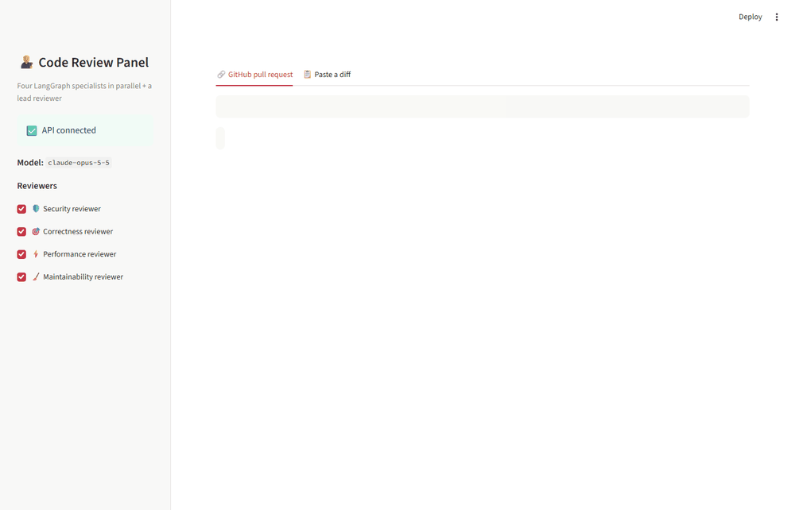
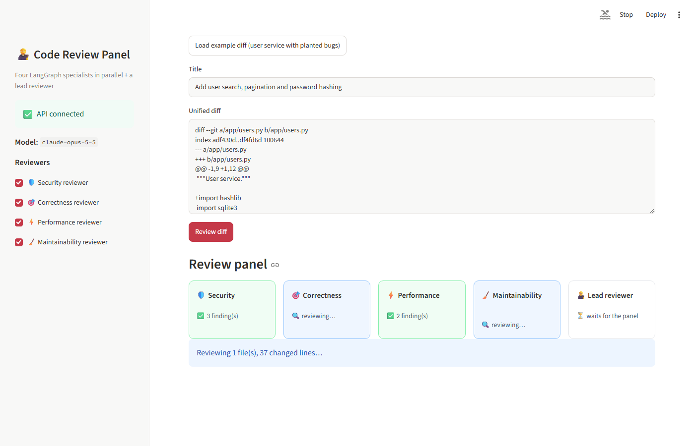
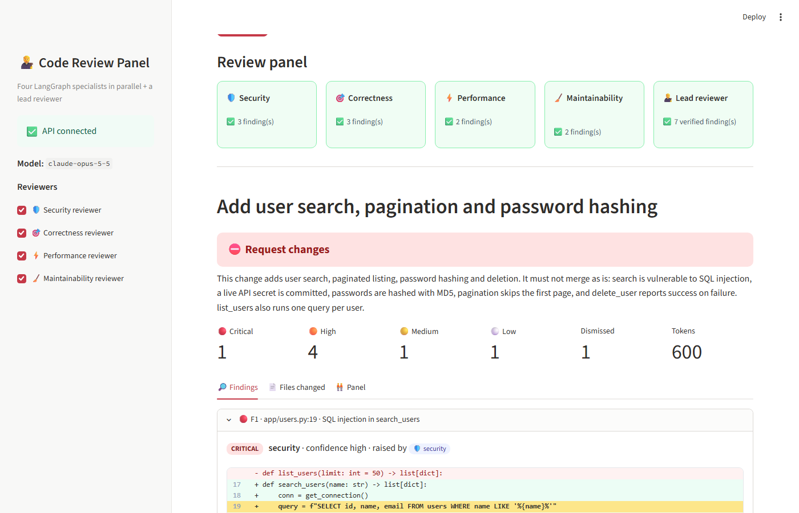
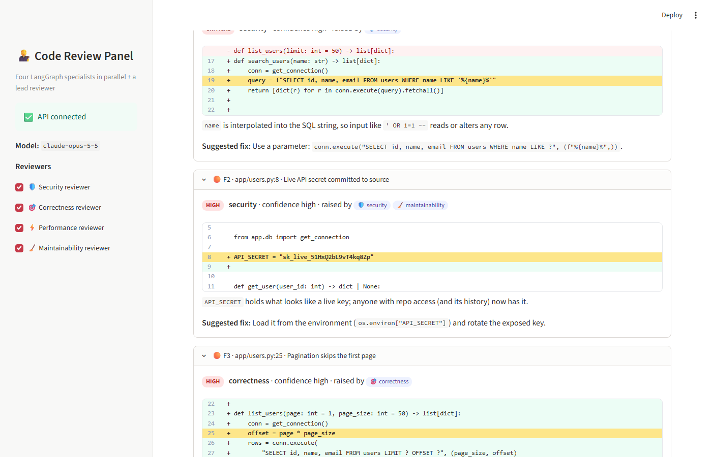
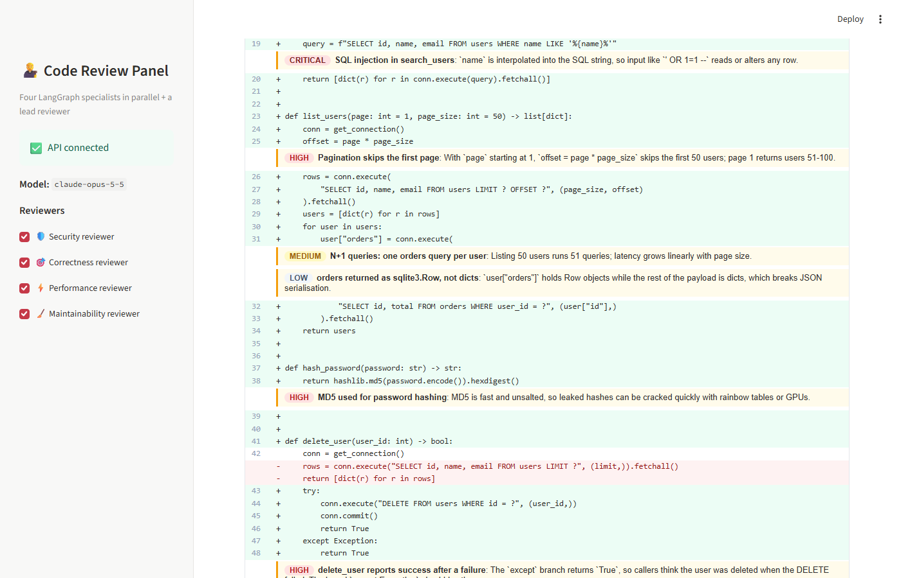
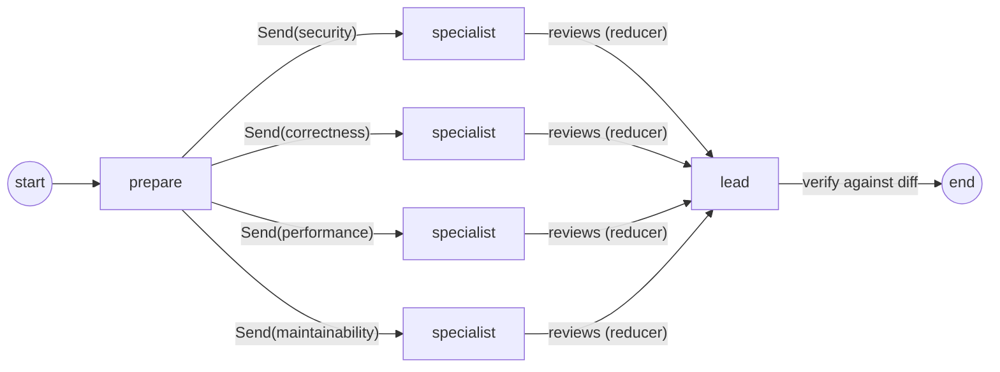

# Multi-Agent Code Review

A panel of AI reviewers for pull requests. Paste a diff or a GitHub PR URL. **Four specialist
agents review it in parallel**: security, correctness, performance and maintainability. A
**lead reviewer** then verifies their findings, merges duplicates, dismisses false positives and
ranks the rest into one structured review with a verdict.

Built with **LangGraph** (`Send` fan-out, reducer fan-in, checkpointer) and **LangChain**
(`ChatAnthropic` with native JSON-schema structured output), served by **FastAPI** with live
Server-Sent Events and a **Streamlit** UI.



<sub>Demo uses scripted model replies for the reviewers; the diff, parsing, verification and UI are real.</sub>

| Live panel | Verdict | Finding with code | Inline diff annotations |
|---|---|---|---|
|  |  |  |  |

## Features

- **Parallel specialists:** LangGraph `Send` runs one branch per reviewer at the same time. Their
  reviews merge back through an `operator.add` reducer. Pick any subset per review.
- **Lead reviewer (judge):** re-checks every finding against the diff, merges duplicates
  (`raised_by: ["security", "maintainability"]`) and calibrates severity. It also records
  **why** each dropped finding was dismissed, and chooses `approve` / `comment` / `request_changes`.
- **Structured output:** every agent returns a Pydantic schema through Claude's **native JSON-schema
  structured outputs** (`method="json_schema"`), so responses always parse. Each finding has
  file, line, severity, title, explanation, suggested fix and confidence.
- **Line-numbered diffs:** the diff parser numbers every line of the new file, so agents cite exact
  lines.
- **Checked in code, not just by the model:** after the lead reviewer,
  [`verify.py`](src/agent/verify.py) checks each finding against the parsed diff:
  - **Exact:** the line exists in the diff.
  - **Adjusted:** the cited line is off, so the finding moves to the nearest changed line.
  - **Unverified:** no matching line was found; the finding is kept but flagged.
  - **Dismissed:** findings on files that aren't in the diff are dropped.

  The verdict is also kept consistent with the findings: a critical finding always means
  `request_changes`.
- **Resilient:** if one specialist fails, the rest of the panel continues. If the lead fails, the
  specialists' findings are merged mechanically instead.
- **GitHub PRs:** fetches the title, description and diff of public PRs (set `GITHUB_TOKEN` for
  private repos and higher rate limits). Oversized diffs are rejected, never silently truncated.
- **Team guidelines:** `data/knowledge_base/*.md` is added to every reviewer's prompt, for example
  "string-built SQL is a blocker".
- **Live UI:** reviewer cards update as each agent finishes. The report shows a verdict banner,
  severity counts, findings with the highlighted code, a GitHub-style diff with inline
  annotations, and the raw panel output.
- **CLI:** review your working tree with `git diff | python main.py cli --diff -`.
- **20 offline tests:** the diff parser (added, deleted and renamed files, `---` lines inside
  hunks), GitHub fetching with a mock transport, parallelism, verification, failure fallbacks
  and SSE.

## Project structure

```
multi-agent-code-review/
├── README.md
├── requirements.txt
├── .env.example            # copy to .env (never commit .env)
├── .gitignore
├── Dockerfile
├── docker-compose.yml      # API on :8000, UI on :8501
├── main.py                 # FastAPI app (`main:app`) + terminal CLI
├── ui/
│   └── app.py              # Streamlit: live panel, verdict, findings, inline diff
├── docs/                   # demo.gif + screenshots
├── src/
│   ├── agent/
│   │   ├── agent.py        # LangGraph graph: prepare -> Send fan-out -> specialists -> lead
│   │   ├── reviewers.py    # the four specialists and their focus areas
│   │   ├── schemas.py      # Pydantic structured-output schemas
│   │   ├── verify.py       # checks findings against the real diff + fallback merge
│   │   ├── state.py        # graph state with reducers (reviews, token usage)
│   │   └── memory.py       # SQLite checkpointer
│   ├── tools/
│   │   ├── diff.py         # unified diff parser with new-file line numbers
│   │   └── github.py       # GitHub PR fetcher (httpx)
│   ├── models/
│   │   └── llm_client.py   # ChatAnthropic + with_structured_output(method="json_schema")
│   ├── prompts/            # specialist + lead prompts, guideline loading
│   ├── utils/              # config (env/.env), logging
│   └── api/
│       ├── reviews.py      # background reviews + event log
│       ├── routes.py       # FastAPI endpoints incl. SSE
│       └── schemas.py      # request/response models
├── tests/                  # test_tools.py, test_agent.py, test_api.py (offline)
├── data/
│   ├── examples/user_service.diff   # sample PR with planted bugs
│   └── knowledge_base/     # team review guidelines
└── logs/
```

## Setup

```bash
cd multi-agent-code-review
python -m venv .venv
# Windows: .venv\Scripts\activate   |   macOS/Linux: source .venv/bin/activate
pip install -r requirements.txt
cp .env.example .env              # then put your ANTHROPIC_API_KEY in .env
```

## Run the API

```bash
uvicorn main:app --reload         # or: python main.py      ->  http://localhost:8000/docs
```

| Method | Path                     | Description                                                   |
|--------|--------------------------|---------------------------------------------------------------|
| GET    | `/health`                | Model, reviewers, whether a GitHub token is set               |
| GET    | `/reviewers`             | The specialists and their focus areas                         |
| POST   | `/reviews`               | Start a review → `{review_id, events_url}`                    |
| GET    | `/reviews/{id}/events`   | **Server-Sent Events**: specialist progress and the report    |
| GET    | `/reviews/{id}`          | Report, raw specialist reviews, files, usage                  |
| GET    | `/reviews/{id}/diff`     | Parsed diff with line numbers (for inline annotations)        |
| GET    | `/reviews`               | Recent reviews with verdict and finding count                 |
| POST   | `/review`                | Review and wait for the result (no streaming)                 |

```bash
# A GitHub PR
curl -X POST localhost:8000/review -H "Content-Type: application/json" \
  -d '{"pr_url": "https://github.com/owner/repo/pull/123"}'

# A local diff, security + correctness only
curl -X POST localhost:8000/review -H "Content-Type: application/json" \
  -d "{\"diff\": $(git diff | python -c 'import json,sys; print(json.dumps(sys.stdin.read()))'), \"reviewers\": [\"security\", \"correctness\"]}"
```

A finding in the report:

```json
{
  "id": "F1", "file": "app/users.py", "line": 19, "location": "exact",
  "severity": "critical", "category": "security", "confidence": "high",
  "title": "SQL injection in search_users",
  "explanation": "`name` is interpolated into the SQL string...",
  "suggestion": "Use a parameter: conn.execute(\"... LIKE ?\", (f\"%{name}%\",))",
  "raised_by": ["security"],
  "code": "    query = f\"SELECT id, name, email FROM users WHERE name LIKE '%{name}%'\""
}
```

## Run the Streamlit UI

With the API running, in a second terminal:

```bash
streamlit run ui/app.py           # http://localhost:8501
```

Click **Load example diff** to review the sample change. It contains a SQL injection, a committed
secret, MD5 password hashing, an off-by-one in pagination, an N+1 query and a function that
reports success after failing.

## Terminal CLI

```bash
python main.py cli --pr https://github.com/owner/repo/pull/123
git diff main | python main.py cli --diff - --reviewers security correctness
```

## Docker

```bash
docker compose up --build         # API on :8000, UI on :8501
```

## Tests

```bash
pytest -q
```

## Configuration

| Variable                 | Default           | Meaning                                           |
|--------------------------|-------------------|---------------------------------------------------|
| `AGENT_MODEL`            | `claude-opus-5-5` | Claude model for every reviewer                   |
| `AGENT_EFFORT`           | `high`            | Thinking depth: `low` … `max`                     |
| `GITHUB_TOKEN`           | *(empty)*         | Private repos and higher GitHub rate limits       |
| `MAX_DIFF_CHARS`         | `150000`          | Larger diffs are rejected (never truncated)       |
| `MAX_CONCURRENT_REVIEWS` | `3`               | Reviews processed at the same time                |

## How the graph works



1. **`prepare`:** parses the diff and builds one shared prompt with title, description and a
   line-numbered diff.
2. **`specialist` x N:** a conditional edge returns one `Send` per selected reviewer, and LangGraph
   runs them in parallel. Each returns a `SpecialistReview`, and the `reviews` reducer appends
   them all.
3. **`lead`:** runs once every branch has finished. It returns a `PanelReport`, which
   [`verify.py`](src/agent/verify.py) then checks against the parsed diff.
4. Every node streams progress with `get_stream_writer()`, and the API relays it as SSE.

## Ideas to extend

- Post the findings back to GitHub as a PR review with inline comments.
- A debate round: show specialists each other's findings before the lead decides.
- A "supervisor" that skips specialists that don't apply (e.g. security for docs-only diffs).
